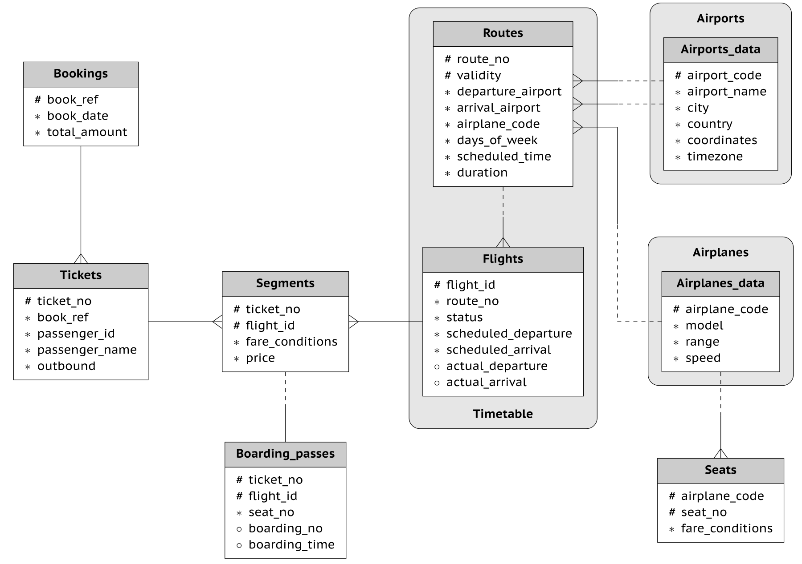

[Source to download db](https://postgrespro.com/community/demodb)  



# Grouping Sets vs Rollup vs Cube
```sql
select arrival_airport, departure_airport, sum(1) 
from routes 
group by grouping sets (arrival_airport, departure_airport, ()) 
order by sum(1) desc;
```
is equivalent to

```sql
select arrival_airport, null as departure_airport, sum(1) as sum 
from routes 
group by arrival_airport 

UNION ALL

select null as arrival_airport, departure_airport, sum(1) as sum
from routes
group by departure_airport

UNION ALL

select null as arrival_airport, null as departure_airport, count(1) as sum from routes
order by sum desc;
```

# Rollup
```sql
select arrival_airport, departure_airport, sum(1) from routes group by rollup (arrival_airport, departure_airport) order by sum(1) desc;
```

is equivalent to

```sql
select arrival_airport, departure_airport, count(1) as cnt
from routes
group by arrival_airport, departure_airport

UNION ALL

select arrival_airport, null as departure_airport, count(1) as cnt
from routes
group by arrival_airport

UNION ALL

select null as arrival_airport, null as departure_airport, count(1) as cnt from routes
order by cnt desc;
```

# Cube
```sql
select arrival_airport, departure_airport, airplane_code, count(1) as cnt 
from routes 
group by cube (arrival_airport, departure_airport, airplane_code) 
order by cnt desc;
```

is equivalent to

```sql
GROUPING SETS (
    ( a, b, c ),
    ( a, b    ),
    ( a,    c ),
    ( a       ),
    (    b, c ),
    (    b    ),
    (       c ),
    (         )
)
```