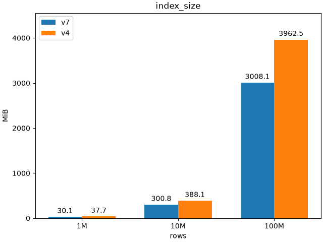
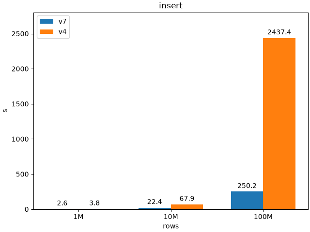

# Introduction
This module contains source code for
the comparison of UUIDv4 vs UUIDv7 impact on
PostgreSQL v18.

## Setup
1. docker-compose up -d
2. python benchmark.py

## Results
- While on a small amount of data the amount of time needed to insert v4 and v7 are so close, on a larger data set UUIDv7 surprisingly wins with almost 10x times faster results than a common UUIDv4.
- Meanwhile, the resulting index size is growing linearly: v7 index size is always about a quarter less than v4.

  
